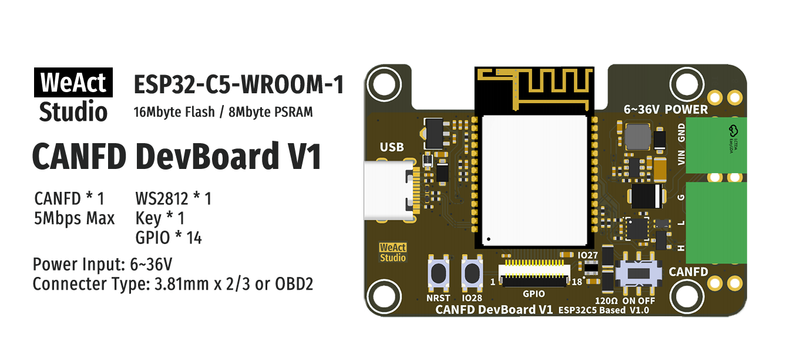

* [中文版本](./README_zh.md)
# WeActStudio.CANFDDevBoardV1_ESP32C5


|Dir Name|Explain|
| :--:|:--:|
|Doc|DataSheet|
|Hardware|Hardware Development Kit|
|Examples|Examples|

## Hardware Version
```
**V1.0**
- Initial version.
```

## Attention
```
Arduino Development Environment:
- ESP32C5 board: `ESP32C5 Dev Module`
```

## Pinout
```
// OBD2
"CANL": 14,
"CANH": 6,
"VIN": 16,
"GND": 4/5,

// CAN
"RX": GPIO24,
"TX": GPIO23,

// Input Voltage
"VIN": GPIO1,
int analogVolts = analogReadMilliVolts(1);
int vin_Volts = analogVolts * ( 51 + 510 + 51 ) / 51;

// WS2812
"LED": GPIO27,

// KEY
"KEY": GPIO28,

// FPC-18Pin-0.5mm Connector
"PIN1": GND,
"PIN2": 3.3V,
"PIN3": GPIO10,
"PIN4": GPIO9,
"PIN5": GPIO8,
"PIN6": GPIO7,
"PIN7": GPIO6,
"PIN8": GPIO0,
"PIN9": GPIO3,
"PIN10": GPIO2,
"PIN11": GPIO26,
"PIN12": GPIO25,
"PIN13": GPIO11,
"PIN14": GPIO12,
"PIN15": GPIO4,
"PIN16": GPIO5,
"PIN17": 5V,
"PIN18": GND,
```

```
/*---------------------------------------
- WeAct Studio Official Link
- taobao: weactstudio.taobao.com
- aliexpress: weactstudio.aliexpress.com
- github: github.com/WeActStudio
- gitee: gitee.com/WeAct-TC
- blog: www.weact-tc.cn
---------------------------------------*/
```
